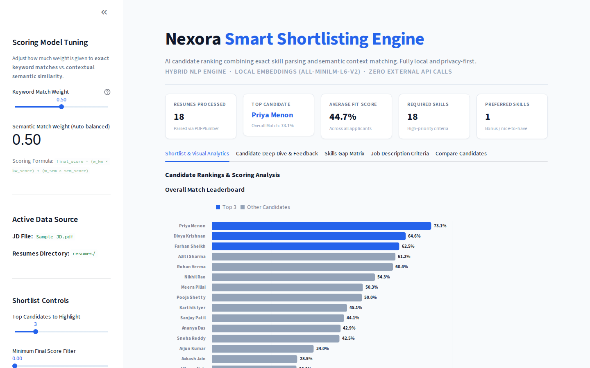
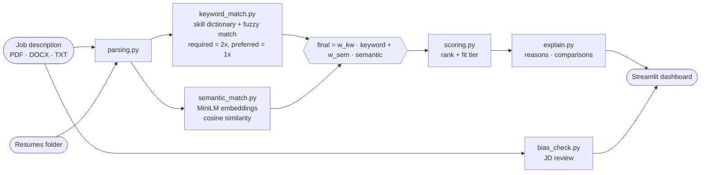

<div align="center">

# 🎯 TalentLens: Smart Shortlisting Engine

### Hybrid AI resume-to-JD ranking, fully offline

**One job description in, a ranked and explainable shortlist out. Zero external API calls.**

Built for the **InternLoom AI Hackathon** at MIT Bengaluru.

[](https://github.com/SlazzInC0de/smart-shortlisting-engine/actions/workflows/tests.yml)




</div>

---

## ✨ Highlights

| | |
|---|---|
| ⚖️ **Hybrid scoring** | Keyword coverage and semantic similarity, blended with a weight you tune live in the sidebar |
| 🧠 **Local embeddings** | `all-MiniLM-L6-v2` runs on your machine; resumes never leave it |
| 📋 **Full ranked shortlist** | Every resume is scored and tiered (Strong, Moderate, Partial, Low), not just a top-N cut |
| 🔍 **Explainable** | Matched and missing skills, the dominant signal, and a recruiter recommendation per candidate |
| 🆚 **Compare candidates** | Pick any two and get a plain-language and tabular breakdown of why one outranks the other |
| ✍️ **Typo tolerant** | Adjacent-transposition and fuzzy matching catch "Pyhton" and "Dcoker" |
| 🧭 **JD bias review** | Flags gendered wording, exclusionary phrases, high flat experience bars and overlong required lists |
| 📂 **Multi-submission aware** | Several files from one candidate are each scored; the best represents them, with the comparison shown |

## 🧮 Scoring model



Both component scores are normalized to [0, 1]. Weights default to 50/50 and live in [`config.py`](config.py).

| Fit tier | Rule |
|---|---|
| 🟢 Strong Match | final ≥ 0.72 and required-skill coverage ≥ 70% |
| 🟡 Moderate Match | final ≥ 0.50 and coverage ≥ 40% |
| 🟠 Partial Fit | final ≥ 0.30 |
| 🔴 Low Fit | below 0.30 |

## 🖥️ Dashboard tabs

1. **Shortlist & Visual Analytics**: leaderboard plus keyword vs. semantic breakdown
2. **Candidate Deep Dive & Feedback**: per-candidate reasoning and recommendation
3. **Skills Gap Matrix**: who has which required skill
4. **Job Description Criteria**: extracted skills and the bias review
5. **Compare Candidates**: head-to-head explanation

## 🚀 Run locally

```bash
git clone https://github.com/SlazzInC0de/smart-shortlisting-engine.git
cd smart-shortlisting-engine
python -m venv .venv && source .venv/bin/activate   # Windows: .venv\Scripts\activate
pip install -r requirements.txt

streamlit run app.py
```

Put one job description in `data/jd/` (any filename; PDF and DOCX are preferred over TXT) and resumes in `data/resumes/`. The repo ships with a sample JD and 18 sample resumes. The embedding model downloads once on first run, then everything works offline.

**Tests**

```bash
pip install pytest
pytest -v
```

## 📁 Project structure

```text
smart-shortlisting-engine/
├── app.py              # Streamlit dashboard
├── config.py           # Weights, model name, data paths
├── parsing.py          # Document parsing, name and role extraction
├── keyword_match.py    # Skill dictionary + typo-tolerant matching
├── semantic_match.py   # Local embeddings + cosine similarity
├── scoring.py          # Hybrid score, tiers, multi-submission handling
├── explain.py          # Candidate explanations and comparisons
├── bias_check.py       # JD bias / narrow-phrasing scanner
├── tests/              # pytest suite
├── data/               # Sample JD and resumes
└── docs/               # Screenshots and hackathon submission
```

## 🏆 Hackathon

The original submission and project report are in [`docs/hackathon/`](docs/hackathon/).

## 📄 License

MIT © [Suryansh Verma](https://github.com/SlazzInC0de)
